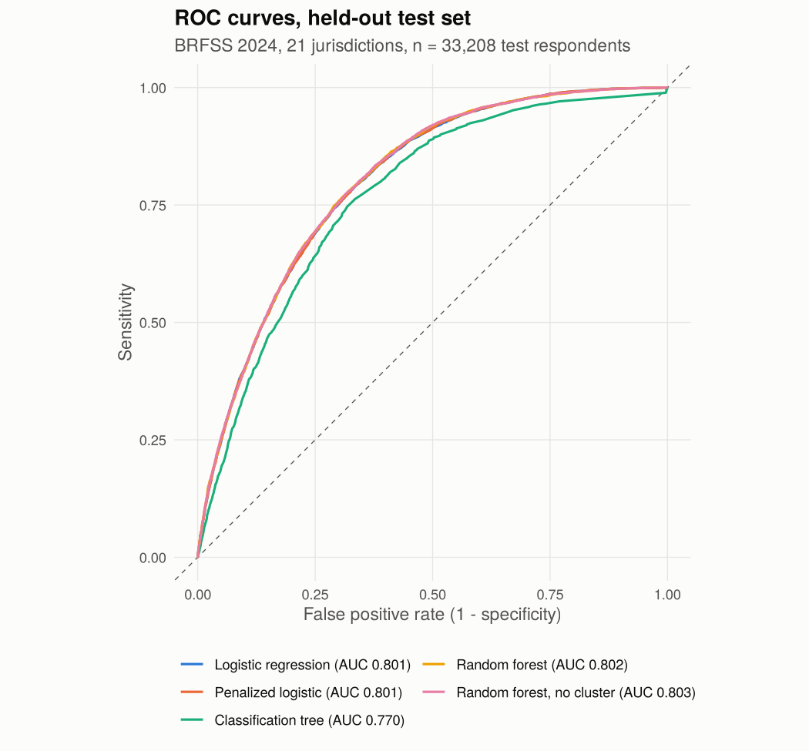
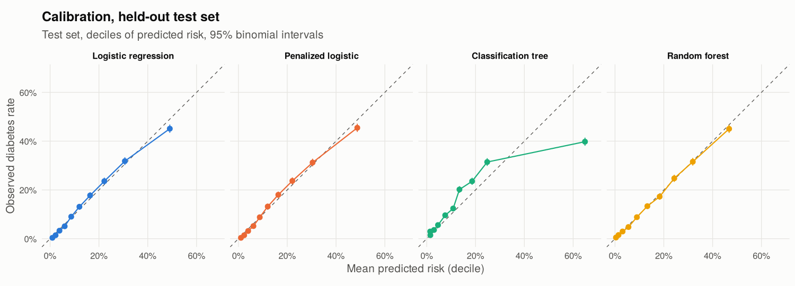
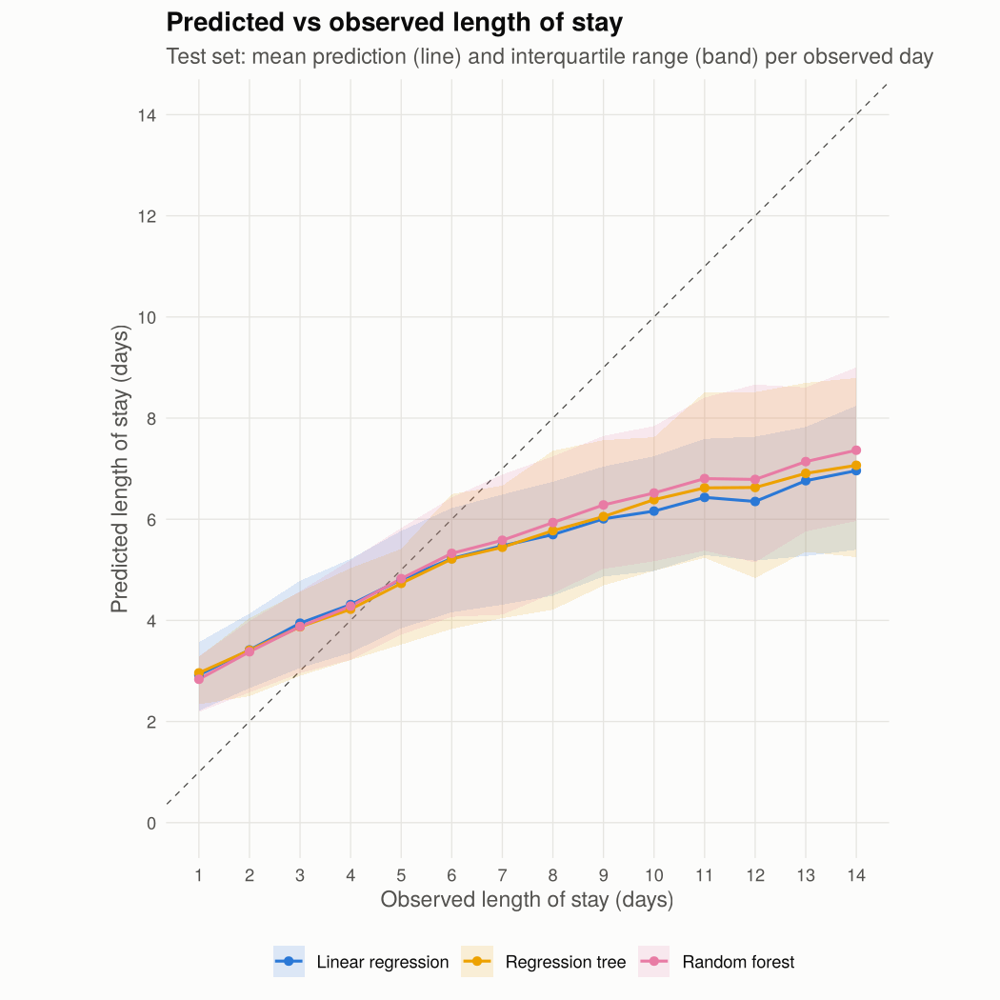

# Diabetes predictive modeling: BRFSS classification and inpatient length of stay

Two leakage-safe machine learning analyses in R: classifying diagnosed diabetes from 2024 BRFSS survey responses, and predicting hospital length of stay for patients with diabetes.

[](https://github.com/rmali0/diabetes-predictive-modeling/actions/workflows/ci.yml)


## Question

1. **Who reports diagnosed diabetes?** Using routinely collected survey items (age, BMI, self-rated health, checkups, cardiovascular and kidney history, income, smoking), how well can standard models identify adults with diagnosed diabetes, and at what cost in false positives if the model were used to prioritize screening?
2. **What tracks with longer hospital stays?** Among inpatients with diabetes, how much of the variation in length of stay can encounter data explain, and does a flexible model beat a linear one?

Both questions come from my background in clinic operations: deciding who to prioritize for testing, and understanding what keeps a bed occupied.

## Data

| Dataset | Rows used | Source and license |
|---|---|---|
| BRFSS 2024, course extract (`data/brfss2024_extract_slim.csv.gz`, 3.9 MB) | 166,043 adults | CDC, public domain |
| Diabetes 130-US Hospitals 1999-2008 (`data/diabetic_data.csv.gz`, 3.2 MB) | 71,515 patients (first encounter of 101,766) | UCI ML Repository, CC BY 4.0 ([Strack et al. 2014](https://doi.org/10.1155/2014/781670)) |

**Important:** the BRFSS file is the extract provided for the course, not the national file. It covers 21 jurisdictions only (state FIPS 1 to 24, Alabama through Maryland), and the Maryland sample is incomplete because the course file stops partway through it. BRFSS results apply to these jurisdictions. `data-raw/prepare_brfss.R` documents how to rebuild the extract from CDC's national `LLCP2024XPT.zip`; it has not been run because the build machine could not reach cdc.gov. Details are in [`data/README.md`](data/README.md).

## Approach

- **Split first.** An 80/20 split happens before any imputation, scaling, rare-level pooling or clustering. Medians, scaling constants and k-means centers come from training rows only and are applied unchanged to test rows.
- **One row per patient** in the hospital data (first encounter), so no patient appears in both training and test sets. About 30% of encounters are repeat visits; splitting encounters at random would let a model score well by recognizing returning patients.
- **Models** (caret, shared 5-fold CV folds): logistic, penalized logistic (glmnet), classification tree (rpart) and random forest (ranger) for BRFSS; linear, ridge, lasso, regression tree and random forest for length of stay.
- **Cluster ablation.** Each analysis adds a k-means cluster feature (risk profile or care complexity) and compares the forest with and without it on the same test set.
- **Evaluation on the held-out test set:** AUC with DeLong 95% CI, average precision, Brier score, calibration by decile, and sensitivity/specificity/PPV at a threshold chosen on out-of-fold training predictions to reach 80% sensitivity (a screening use should miss few cases). For length of stay: RMSE, MAE, R-squared, residual diagnostics and paired bootstrap CIs for RMSE differences.
- **Context, not modeling:** survey-weighted diabetes prevalence (survey package, `_STSTR` strata, `_LLCPWT` weights). The classifiers themselves are unweighted predictive models.

## Key results

### Diagnosed diabetes (BRFSS 2024, 33,208 test respondents, 15.1% prevalence)

| Model | Test AUC (95% CI) | Avg. precision | Brier | Sensitivity | Specificity | PPV |
|---|---|---|---|---|---|---|
| Random forest, no cluster | 0.803 (0.797 to 0.809) | 0.394 | 0.1075 | 0.801 | 0.656 | 0.292 |
| Random forest | 0.802 (0.797 to 0.808) | 0.395 | 0.1075 | 0.796 | 0.660 | 0.293 |
| Penalized logistic | 0.801 (0.795 to 0.807) | 0.392 | 0.1082 | 0.800 | 0.654 | 0.291 |
| Logistic regression | 0.801 (0.795 to 0.807) | 0.392 | 0.1082 | 0.800 | 0.653 | 0.290 |
| Classification tree | 0.770 (0.763 to 0.777) | 0.336 | 0.1218 | 0.807 | 0.603 | 0.264 |

Sensitivity, specificity and PPV are at each model's 80%-sensitivity threshold from training data. Predicting the training prevalence for everyone gives a Brier score of 0.1279.

- Logistic regression is essentially as good as the random forest (AUC difference 0.002, DeLong p = 0.16), and its calibration is close to the diagonal except for slight over-prediction in the top decile. For any practical use I would prefer it because it is transparent.
- At 80% sensitivity, about 41% of respondents are flagged and only 29% of those flagged have diagnosed diabetes. Discrimination is moderate; the precision-recall view makes the cost of the class imbalance visible.
- The k-means risk-profile cluster added nothing (forest AUC difference -0.0002, p = 0.73): the forest already captures the age, BMI and unhealthy-days pattern the cluster summarizes.
- Survey-weighted prevalence of the outcome in the 20 complete jurisdictions is 12.7% (95% CI 12.3% to 13.0%), versus 15.0% unweighted, partly because respondents skew older (38.2% aged 65+ versus 23.7% weighted). Model probabilities reflect the sample, not the population.





### Inpatient length of stay (14,302 test patients)

| Model | Test RMSE (days) | Test MAE (days) | Test R-squared |
|---|---|---|---|
| Random forest | 2.287 | 1.726 | 0.395 |
| Random forest, no cluster | 2.287 | 1.726 | 0.394 |
| Regression tree | 2.367 | 1.791 | 0.351 |
| Lasso | 2.369 | 1.804 | 0.350 |
| Linear regression | 2.369 | 1.804 | 0.350 |
| Ridge | 2.369 | 1.806 | 0.350 |
| Training mean (no model) | 2.939 | 2.311 | 0.000 |

- The forest lowers test RMSE by 0.082 days versus linear regression (paired bootstrap 95% CI 0.068 to 0.095).
- All models shrink toward the mean: short stays are over-predicted and long stays under-predicted. About 1% of linear predictions fall below one day.
- Number of medications, discharge disposition and number of lab procedures dominate permutation importance. These are recorded during or at the end of the stay, so the models describe what tracks with longer stays rather than forecasting at admission.
- The care-complexity cluster again made no measurable difference (RMSE difference -0.0004 days, 95% CI -0.004 to 0.003).



Full write-ups with all tables and figures (precision-recall curves, permutation importance, residual plots, cluster profiles, PCA check): [`analysis/01_brfss_diabetes_classification.md`](analysis/01_brfss_diabetes_classification.md) and [`analysis/02_inpatient_los_regression.md`](analysis/02_inpatient_los_regression.md).

## Limitations

- **BRFSS coverage:** 21 jurisdictions only, with an incomplete Maryland sample. Results should not be read as national.
- **Cross-sectional self-report.** People who already know they have diabetes may report worse health, more checkups or changed behavior because of the diagnosis. The model identifies who reports diabetes, not who will develop it, and undiagnosed diabetes is counted as "no".
- **Outcome definition:** prediabetes (DIABETE4 = 4) is grouped with "no" and gestational-only diabetes is excluded, following the original design.
- **Unweighted models.** Predicted probabilities are calibrated to the sample, which over-represents older adults.
- **Length-of-stay predictors are not admission-time data,** the hospital data are from 1999-2008, and keeping first encounters drops about 30% of encounters. Admission and discharge codes are kept as ID categories without label mapping.
- **One train/test split.** The confidence intervals reflect test-set sampling only, not variation from re-splitting or re-tuning. Tuning grids were kept small to fit a 15-minute run on two cores.

## How to run

Requires R (tested on 4.3.3) with caret, ranger, glmnet, rpart, pROC, survey, data.table, ggplot2, scales, rmarkdown, knitr and testthat. Exact versions from the reported run are in [`outputs/session_info.txt`](outputs/session_info.txt).

```bash
make all      # or: Rscript run_all.R   (about 15 minutes on 2 cores)
make test     # unit tests for recoding, preprocessing and metrics
make quick    # small smoke run on a subsample; writes to a temp folder only
```

`run_all.R` renders both notebooks to GitHub markdown and regenerates everything in `outputs/`. Thread use is capped at 4 (set `N_THREADS` to change it). Random seeds are fixed.

## Repository layout

```
diabetes-predictive-modeling/
|-- R/
|   |-- utils.R              paths, formatting, thread and quick-run settings
|   |-- recode_brfss.R       BRFSS codebook recodes (88, 77/99, _BMI5 / 100, ...)
|   |-- recode_hospital.R    first encounter per patient, age bands, rare levels
|   |-- preprocess.R         train-only imputation and k-means cluster feature
|   |-- models.R             caret model specifications and shared CV folds
|   |-- evaluate.R           AUC CI, average precision, Brier, calibration, thresholds
|   `-- plots.R              figure theme and plotting helpers
|-- analysis/
|   |-- 01_brfss_diabetes_classification.Rmd / .md
|   `-- 02_inpatient_los_regression.Rmd / .md
|-- data/                    gzipped source data and provenance README
|-- data-raw/prepare_brfss.R rebuild the BRFSS extract from CDC's national file
|-- outputs/
|   |-- figures/             PNG figures used here and in the notebooks
|   |-- tables/              CSV results
|   `-- session_info.txt     R and package versions from the reported run
|-- tests/testthat/          unit tests on small fixtures
|-- .github/workflows/ci.yml runs the tests on GitHub Actions
|-- run_all.R
`-- Makefile
```

## Course context and what changed

I originally built this for HDS-5330 Predictive Modeling and Health Machine Learning at Saint Louis University (Spring 2026) as an individual final project. This repository is a cleaned-up portfolio version. It keeps the original questions, datasets, model families and k-means cluster ablation, with these changes:

- **Leakage fixes.** Median imputation and k-means clustering were fit on all rows before the train/test split; they are now fit on training rows only and applied to test rows.
- **Patient-level split.** The hospital analysis split encounters at random, so repeat patients could sit in both training and test sets. It now uses one encounter per patient.
- **Held-out evaluation.** The course version reported cross-validated metrics only and never scored the test set. Models are now evaluated once on the test set with confidence intervals, calibration, Brier score and precision-recall.
- **Threshold.** Sensitivity at the default 0.5 cut-off was low. The threshold is now chosen on out-of-fold training predictions for 80% sensitivity.
- **Full data.** The 12,000-row subsample was dropped; all eligible rows are used, with `ranger` (200 trees) in place of `randomForest` (50 trees) for speed.
- **Coding fix.** CHECKUP1 = 8 ("never had a routine checkup") was treated as missing; it is now its own category. Other recodes were checked against the 2024 codebook.
- **Redundant predictors removed.** `_TOTINDA`, `_RFHLTH` and `_MICHD` are exact recodes of EXERANY2, GENHLTH and CVDINFR4/CVDCRHD4, which were already in the model.
- **Rare categories** in the hospital data are pooled using training counts, so test rows never carry a level the model has not seen.
- **Tree tuning.** The default complexity search stopped at a few leaves on the imbalanced BRFSS outcome; the grid now reaches smaller values. The selected BRFSS tree has 1,705 leaves, so it discriminates better but is no longer a readable rule set.
- **Importance.** Averaging caret's scaled importance across models mixed incomparable scales; it is replaced by test-set permutation importance.
- **Added** survey-weighted prevalence for context, residual diagnostics, paired model comparisons, unit tests, CI and a one-command build.
- **Removed** course-specific pieces: the hand-written 10-fold CV loop that checked caret, caret box and dot plots, PDF formatting and package-install code. The PCA check is kept.

## Author

Richard Mali, MS Health Data Science student, Saint Louis University. [LinkedIn](https://linkedin.com/in/richardmali)

I used Claude as a coding assistant for refactoring and testing; analysis decisions and interpretation are mine.
