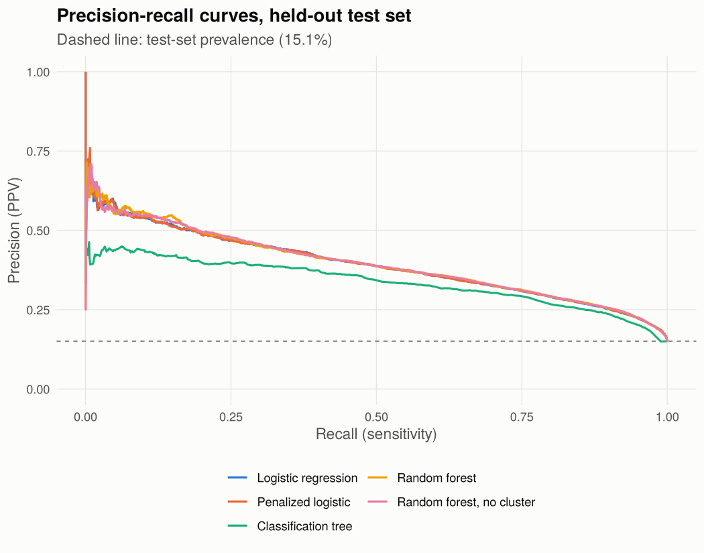
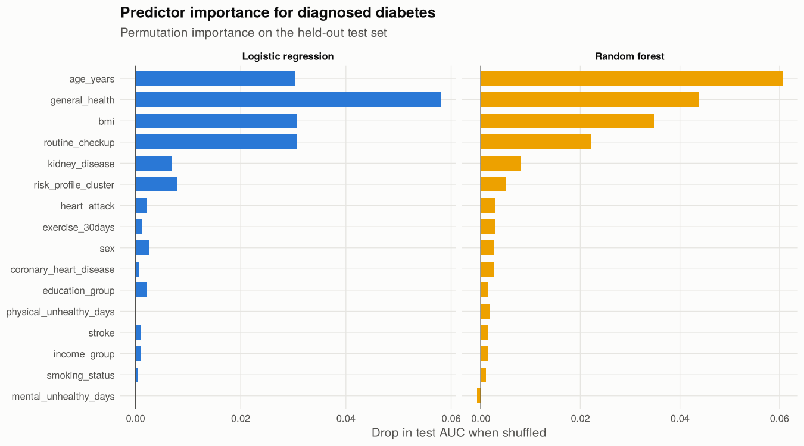

Classifying diagnosed diabetes from BRFSS 2024 survey responses
================
Richard Mali

This notebook fits five classifiers for self-reported diagnosed diabetes
using 2024 BRFSS predictors, then evaluates them once on a held-out test
set. All preprocessing that estimates anything from data (median
imputation, scaling, the k-means risk-profile cluster) is fit on the
training rows only.

## 1. Data and cohort

The file is the course-provided extract of the 2024 BRFSS combined
landline and cell phone data. It is **not the national file**: it holds
167,655 records from 21 jurisdictions (state FIPS 1 to 24, Alabama,
Alaska, Arizona, Arkansas, California, Colorado, Connecticut, Delaware,
District of Columbia, Florida, Georgia, Hawaii, Idaho, Illinois,
Indiana, Iowa, Kansas, Kentucky, Louisiana, Maine, Maryland). Results
describe respondents in these jurisdictions only.

The extract appears to be the first part of the national file, cut off
partway through Maryland: Maryland’s final weights sum to only 2.81
million, far below its adult population, while the other jurisdictions
look complete. Maryland respondents are kept for modeling but excluded
from the survey-weighted estimates below.

The outcome is DIABETE4 = 1 (“ever told you have diabetes”) versus 3
(no) or 4 (no, prediabetes or borderline). I excluded gestational-only
diabetes (code 2, n = 1,242), don’t know (7, n = 292), refused (9, n =
76) and blanks. The analytic cohort has 166,043 respondents and an
unweighted prevalence of 15.1%.

Coding checks against the 2024 codebook, applied in `R/recode_brfss.R`:

- PHYSHLTH and MENTHLTH: 88 means zero days; 77 and 99 are set to
  missing.
- `_BMI5` has two implied decimals, so BMI = `_BMI5` / 100; blanks are
  missing.
- CHECKUP1 = 8 means “never had a routine checkup”. The course version
  treated it as missing; here it is its own level.
- Calculated variables use 9 for don’t know or missing; those, and 7/9
  on the yes/no items, become an explicit `Missing` level.
- `_TOTINDA`, `_RFHLTH` and `_MICHD` are dropped because they are
  recodes of EXERANY2, GENHLTH and CVDINFR4/CVDCRHD4, which are already
  in the model. The agreement check below confirms the overlap.

| Dropped variable | Derived from         | Rows that agree |
|:-----------------|:---------------------|:----------------|
| \_TOTINDA        | EXERANY2             | 99.999%         |
| \_RFHLTH         | GENHLTH              | 99.999%         |
| \_MICHD          | CVDINFR4 or CVDCRHD4 | 100.000%        |

## 2. Survey-weighted prevalence (context only)

The models below are unweighted predictive models: they learn from the
sample as drawn and are evaluated on held-out respondents. To put the
sample prevalence in context, I estimated weighted prevalence with the
BRFSS design (strata `_STSTR`, final weight `_LLCPWT`, one respondent
per PSU) over the 20 complete jurisdictions.

| Definition                                | Weighted prevalence | 95% CI low | 95% CI high |
|:------------------------------------------|:--------------------|:-----------|:------------|
| Diagnosed diabetes, DIABETE4 = 1 vs 2/3/4 | 12.6%               | 12.2%      | 12.9%       |
| Model outcome, DIABETE4 = 1 vs 3/4        | 12.7%               | 12.3%      | 13.0%       |

Weighted prevalence of the model outcome is 12.7% (95% CI 12.3% to
13.0%), against an unweighted 15.0% in the same jurisdictions. Much of
the gap is age: 38.2% of these respondents are 65 or older, versus a
weighted 23.7%. Predicted probabilities from the unweighted models
therefore reflect the sample, not the adult population. State estimates
are in `outputs/tables/brfss_weighted_prevalence_by_state.csv`.

## 3. Train/test split and train-only preprocessing

I split 80/20, stratified on the outcome (train n = 132,835, test n =
33,208), before any imputation or clustering. Training medians fill
missing numeric values (BMI is missing for 9.0% of training rows). The
k-means risk-profile cluster (k = 3, 20 starts) is fit on standardized
age, BMI and unhealthy days in the training set; test respondents are
assigned to the nearest training center.

| Cluster |   Age |   BMI | Phys. days | Ment. days | Train n | Diabetes rate |
|:--------|------:|------:|-----------:|-----------:|--------:|:--------------|
| 1       | 68.08 | 27.87 |       1.40 |       1.23 |   67094 | 18.4%         |
| 2       | 35.97 | 28.55 |       1.51 |       5.91 |   48373 | 5.4%          |
| 3       | 60.60 | 30.19 |      25.64 |      12.43 |   17368 | 29.0%         |

### PCA check

On the dummy-coded training predictors, 30 of 40 principal components
are needed to explain 90% of the variance, so PCA would compress little
and cost interpretability. I kept the original variables.

## 4. Models and cross-validation

All models share the same five stratified folds of the training set and
are tuned on cross-validated AUC.

| Model               | 5-fold CV AUC | Selected tuning                          |
|:--------------------|:--------------|:-----------------------------------------|
| Logistic regression | 0.802         | none                                     |
| Penalized logistic  | 0.802         | alpha=0.5, lambda=0.000518               |
| Classification tree | 0.770         | cp=5e-05                                 |
| Random forest       | 0.804         | mtry=3, splitrule=gini, min.node.size=25 |

The random forest uses `ranger` with 200 trees; the no-cluster forest
reuses the tuned settings of the main forest and is trained on the same
rows without the cluster feature. The selected classification tree (cp =
0.00005) has 1,705 leaves. At this sample size a deep tree discriminates
better than a shallow one, but it is no longer a short rule set someone
could read, which was the reason for including a tree. Model fitting
took 8.7 minutes on 2 threads.

## 5. Held-out test performance

The decision threshold for each model is the highest cut-off that
reaches 80% sensitivity in that model’s **out-of-fold training
predictions**. I targeted sensitivity because, for a screening use, a
missed case (someone who never gets an HbA1c test) costs more than an
extra test. Choosing the threshold on training data keeps the test set
untouched until final scoring.

| Model                     | AUC (95% CI)           | Avg. precision | Brier  | Threshold | Sensitivity | Specificity | PPV   |
|:--------------------------|:-----------------------|:---------------|:-------|:----------|:------------|:------------|:------|
| Random forest, no cluster | 0.803 (0.797 to 0.809) | 0.394          | 0.1075 | 0.149     | 0.801       | 0.656       | 0.292 |
| Random forest             | 0.802 (0.797 to 0.808) | 0.395          | 0.1075 | 0.151     | 0.796       | 0.660       | 0.293 |
| Penalized logistic        | 0.801 (0.795 to 0.807) | 0.392          | 0.1082 | 0.134     | 0.800       | 0.654       | 0.291 |
| Logistic regression       | 0.801 (0.795 to 0.807) | 0.392          | 0.1082 | 0.134     | 0.800       | 0.653       | 0.290 |
| Classification tree       | 0.770 (0.763 to 0.777) | 0.336          | 0.1218 | 0.106     | 0.807       | 0.603       | 0.264 |

For reference, predicting the training prevalence for everyone gives a
Brier score of 0.1279 on this test set. The best Brier score, 0.1075, is
a 15.9% reduction from that baseline.

Paired DeLong tests on the test set:

| Comparison                                       | AUC difference | p value |
|:-------------------------------------------------|:---------------|:--------|
| Random forest, no cluster vs Logistic regression | 0.0019         | 0.156   |
| Random forest vs Random forest, no cluster       | -0.0002        | 0.726   |

With about one positive in seven, precision is the harder number. At the
80%-sensitivity threshold the best model flags 41.3% of test
respondents, and 29.2% of those flagged have diagnosed diabetes.

## 6. Which predictors matter

Permutation importance is the drop in test AUC when one predictor is
shuffled. It is computed the same way for the logistic model and the
random forest, so the two can be compared on one scale.

## 7. Summary

- Best test AUC: Random forest, no cluster, 0.803 (95% CI 0.797 to
  0.809). Logistic regression reached 0.801.
- The k-means cluster changed random forest test AUC by -0.0002 (DeLong
  p = 0.726).
- Top predictors by permutation importance: general_health,
  routine_checkup, bmi, age_years (logistic) and age_years,
  general_health, bmi, routine_checkup (random forest).
- These are associations in cross-sectional survey data. A respondent
  who already knows they have diabetes may report worse health or more
  checkups because of the diagnosis, so the model describes who reports
  diabetes rather than who will develop it.

Notebook runtime: 9.8 minutes.
