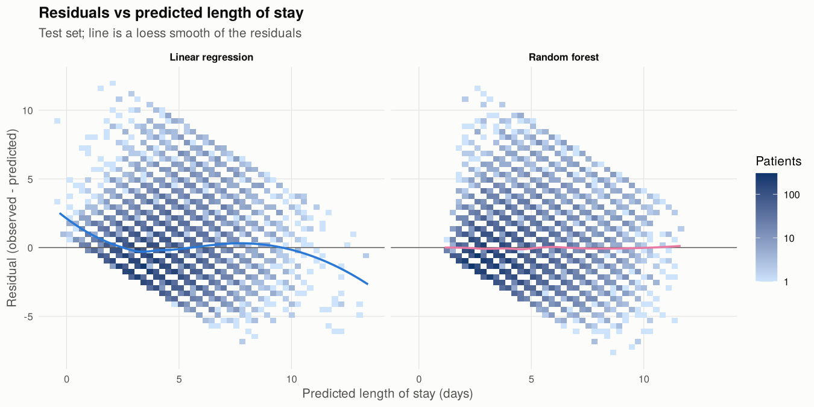
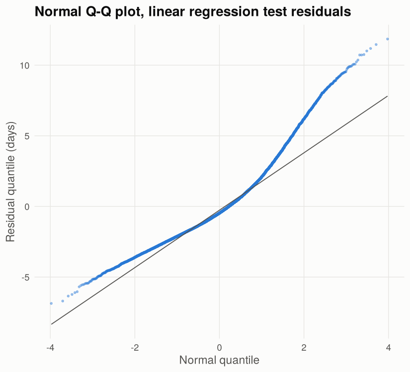
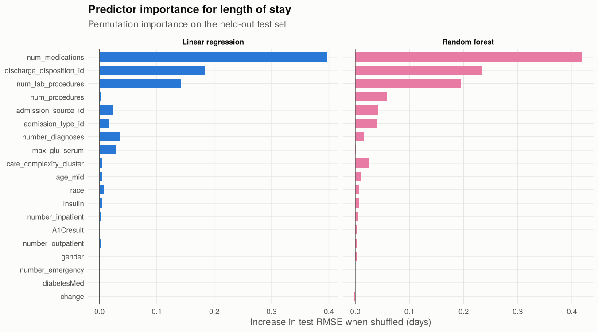

Predicting inpatient length of stay for patients with diabetes
================
Richard Mali

This notebook fits five regression models for `time_in_hospital` (days,
1 to 14) in the UCI Diabetes 130-US Hospitals data and evaluates them
once on held-out patients. Rare-level lumping, median imputation,
scaling and the k-means care-complexity cluster are all fit on training
patients only.

## 1. Data and cohort

The raw file has 101,766 encounters from 71,518 patients; 29.7% of
encounters are repeat visits by a patient already in the data. In the
course version, encounters were split at random, so the same patient
could appear in both training and test data. Repeat stays of one person
share diagnoses, medications and care patterns, so that split rewards a
model for recognizing patients rather than for generalizing to new ones,
and it also makes CV folds within the training set leak in the same way.

Here I keep each patient’s first encounter (lowest `encounter_id`) and
drop the 3 first encounters with gender recorded as Unknown/Invalid. The
analytic cohort has 71,515 patients, one row each, so a random split is
a split by patient. Mean length of stay is 4.29 days (median 3).

Coding notes (`R/recode_hospital.R`): `?` is missing; missing race is
kept as a `Missing` level; age bands such as `[70-80)` become midpoints
(75); `max_glu_serum` and `A1Cresult` of `None` mean the test was not
done and become `Not_measured`; admission type, discharge disposition
and admission source are ID codes treated as categories.

## 2. Train/test split and train-only preprocessing

The 80/20 split is stratified on length-of-stay quantiles (train n =
57,213, test n = 14,302). Category levels with fewer than 30 training
patients are pooled into `Other` (this affected admission_type_id,
discharge_disposition_id, admission_source_id), using training counts
only. The care-complexity cluster (k = 3, 20 starts) is fit on
standardized age and the seven utilization counts in the training set;
test patients are assigned to the nearest training center.

| Cluster |   Age |  Labs | Procedures | Medications | Outpatient | Emergency | Inpatient | Diagnoses | Train n | Mean LOS |
|:--------|------:|------:|-----------:|------------:|-----------:|----------:|----------:|----------:|--------:|---------:|
| 1       | 72.18 | 44.67 |       0.65 |       14.67 |       0.40 |      0.15 |      0.27 |      8.42 |   26607 |     4.36 |
| 2       | 57.08 | 35.74 |       0.91 |       11.33 |       0.14 |      0.06 |      0.07 |      5.07 |   18567 |     3.12 |
| 3       | 64.57 | 50.68 |       3.96 |       24.64 |       0.21 |      0.07 |      0.13 |      7.99 |   12039 |     5.92 |

### PCA check

On the dummy-coded training predictors, 45 of 58 components are needed
for 90% of the variance, so I kept the original variables.

## 3. Models and cross-validation

| Model             | 5-fold CV RMSE | 5-fold CV MAE | Selected tuning                              |
|:------------------|:---------------|:--------------|:---------------------------------------------|
| Linear regression | 2.387          | 1.805         | none                                         |
| Ridge             | 2.388          | 1.807         | alpha=0, lambda=0.0886                       |
| Lasso             | 2.387          | 1.805         | alpha=1, lambda=0.00113                      |
| Regression tree   | 2.387          | 1.793         | cp=3e-04                                     |
| Random forest     | 2.288          | 1.719         | mtry=6, splitrule=variance, min.node.size=20 |

The forest uses `ranger` with 200 trees; the no-cluster forest reuses
its tuned settings without the cluster feature. The selected regression
tree has 96 leaves. Model fitting took 4.5 minutes on 2 threads.

## 4. Held-out test performance

| Model                     | Test RMSE (days) | Test MAE (days) | Test R-squared |
|:--------------------------|:-----------------|:----------------|:---------------|
| Random forest             | 2.287            | 1.726           | 0.395          |
| Random forest, no cluster | 2.287            | 1.726           | 0.394          |
| Regression tree           | 2.367            | 1.791           | 0.351          |
| Lasso                     | 2.369            | 1.804           | 0.350          |
| Linear regression         | 2.369            | 1.804           | 0.350          |
| Ridge                     | 2.369            | 1.806           | 0.350          |
| Training mean (no model)  | 2.939            | 2.311           | 0.000          |

R-squared is computed on the test set as 1 - SSE/SST around the test
mean. Differences in test RMSE, with 95% paired bootstrap intervals
(2,000 resamples of test patients):

| Comparison                                    | RMSE difference | 95% CI low | 95% CI high |
|:----------------------------------------------|:----------------|:-----------|:------------|
| Random forest minus Linear regression         | -0.0820         | -0.0950    | -0.0683     |
| Random forest minus Random forest, no cluster | -0.0005         | -0.0042    | 0.0032      |

All models pull predictions toward the mean: short stays are
over-predicted and long stays under-predicted. This is what an R-squared
near 0.39 looks like in practice.

### Residual diagnostics

The diagonal stripes are there because the outcome is whole days. The
linear model’s residual smooth bends at both ends: it under-predicts
patients it scores lowest and over-predicts those it scores highest, and
1.0% of its test predictions are below one day, which is impossible for
an inpatient stay. The forest’s residuals stay centered across the
range, which matches its lower test error. Residuals are also
right-skewed (skewness 1.08 for the linear model). RMSE and MAE remain
valid accuracy summaries, but normal-theory standard errors for the
linear model’s coefficients would not be, so I compare models on test
error rather than on coefficient p-values. A count model (Poisson or
negative binomial) is a natural next step.

## 5. Which predictors matter

Permutation importance here is the increase in test RMSE when one
predictor is shuffled.

## 6. Summary

- Lowest test RMSE: Random forest, 2.287 days (MAE 1.726, R-squared
  0.395), versus 2.939 days for predicting the training mean.
- The care-complexity cluster changed random forest test RMSE by -0.0005
  days (95% CI -0.0042 to 0.0032).
- Top predictors by permutation importance: num_medications,
  discharge_disposition_id, num_lab_procedures, number_diagnoses
  (linear) and num_medications, discharge_disposition_id,
  num_lab_procedures, num_procedures (random forest).
- Several predictors (number of lab tests, medications, procedures and
  diagnoses, and discharge disposition) are only known during or at the
  end of the stay. The models therefore describe what tracks with longer
  stays; they are not admission-time forecasts.

Notebook runtime: 5.0 minutes.
